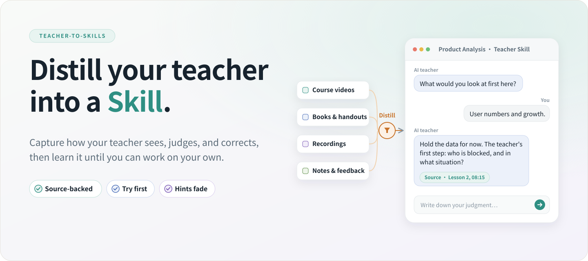
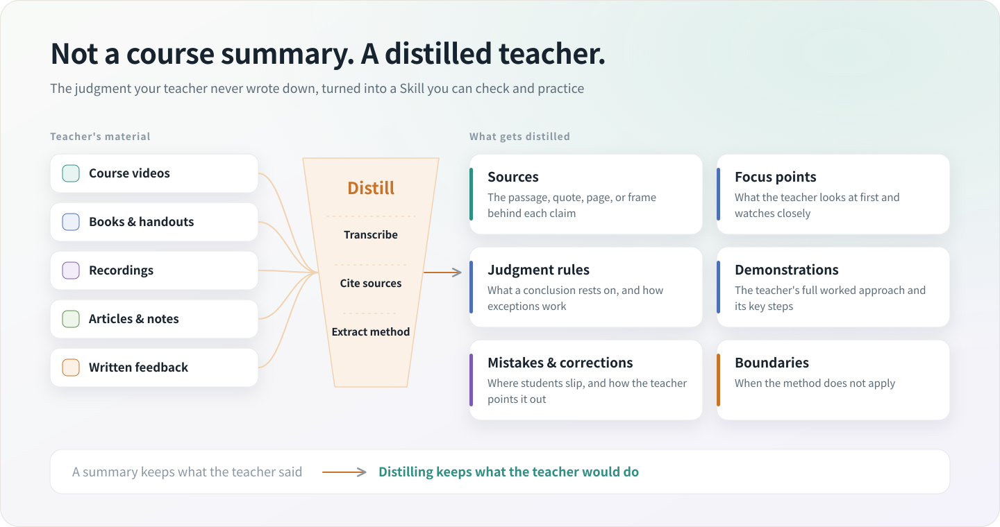
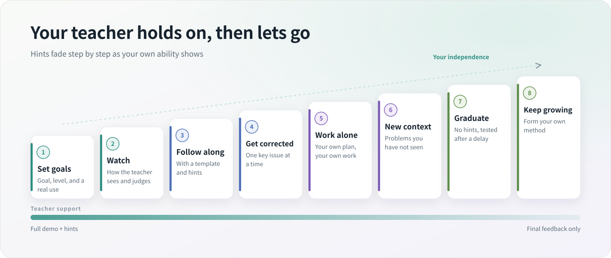
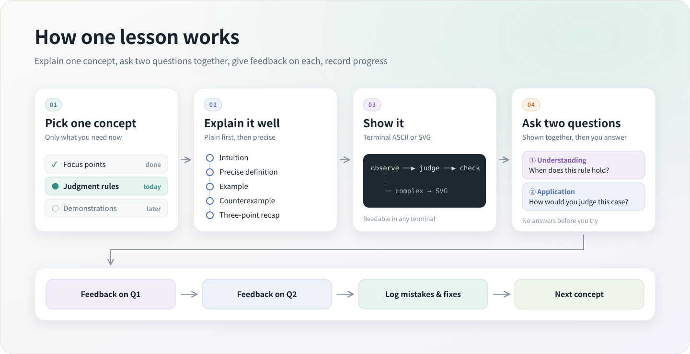
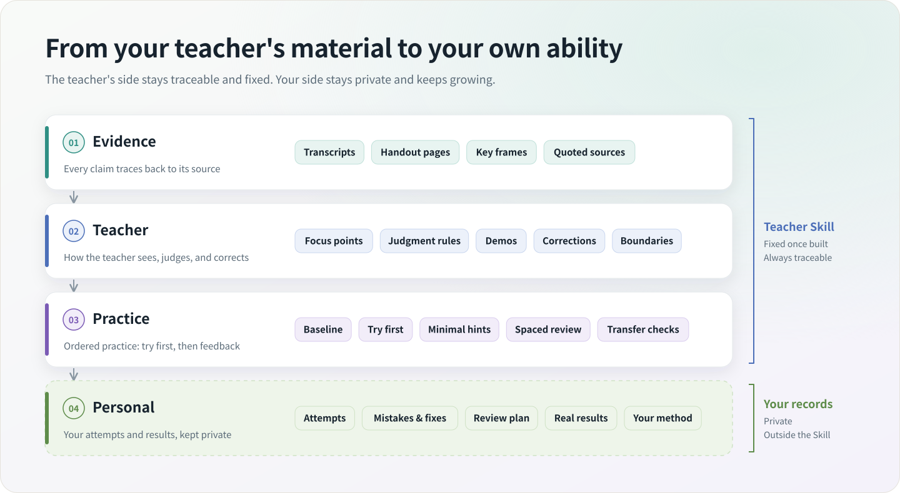

# Teacher-to-Skills

**Distill your teacher into a Skill you can ask anytime and practice with**

[中文](./README.md) · **English** · [Get started](#get-started-in-three-steps) · [Materials](#what-material-can-be-distilled) · [How it works](#how-it-works) · [Installation](./docs/install.md) · [Changelog](./CHANGELOG.md)

 

Give it a teacher's courses, books, recordings, handouts, and written feedback. It extracts **how the teacher looks at a problem, makes judgments, and corrects mistakes**, then packages that into a source-backed AI teacher: it demonstrates, lets you try, gives feedback by the teacher's standards, and steps back until you no longer need it.

| You hand over | It distills | You get |
| --- | --- | --- |
| The teacher's course videos, books and handouts, recordings, articles and notes, written feedback | Sources, focus points, judgment rules, demonstrations, mistakes and corrections, boundaries | An AI teacher you can ask anytime, who sets tasks, reviews by the teacher's standards, and lets go over time |

## Why distill a teacher instead of summarizing a course

What makes a good teacher valuable is rarely the conclusions on the slides. It is the part they never write down: where they look first, what their judgment rests on, where students usually go wrong, and when the method should not be used.

A summary keeps what the teacher said. Teacher-to-Skills keeps what the teacher would do, then turns it into something you can do yourself.

| | Course summary | Distilled teacher Skill |
| --- | --- | --- |
| What it keeps | Topics and conclusions | The teacher's focus points, judgment rules, demonstrations, and corrections |
| How you use it | You read it | It sets a task, you try first, it reviews by the teacher's standards |
| Trust | Hard to tell quotes from paraphrase | Important claims trace back to the original passage, quote, or key visual |
| Outcome | Done once you finish reading | You can do the work yourself, later and in new situations |

It **never** claims to clone a teacher's personality, consciousness, or complete experience. Anything the material does not support is marked as missing evidence, not filled in with "the teacher would probably say".

## How the distilled teacher coaches you

- **Baseline first**: learns your goal, current level, and a real situation you care about, then starts with the concept you need most.
- **You try first**: each concept ends with two questions shown together, one for understanding and one for application, each evaluated separately.
- **Corrections by the teacher's standards**: each round targets the single most important problem, gives only the hint you need, and asks you to revise.
- **Remembers your mistakes**: keeps your attempts, errors, and revisions, and schedules review around weak spots without repeating the original questions.
- **Steps back over time**: templates and hints fade as you improve, ending with unseen situations and no hints.
- **Knows when you have graduated**: mastery means you can still do it after a delay, apply it in a new context, and recognize its limits.

The goal is not permanent dependence on an AI teacher. It is to learn the teacher's method and, eventually, form your own.

## Get started in three steps

You do not need to run scripts or understand the internal file structure. Just talk to your AI assistant in plain language.

**① Install**

Send the [installation guide](./docs/install.md) to your AI assistant (Claude Code, Codex, OpenClaw, and others), let it install the Skill, and restart when prompted.

**② Hand over the teacher's material and distill**

Upload files or point to the folder, then say:

> Use Teacher-to-Skills to distill this teacher's material into a teacher Skill that can help me genuinely learn. My goal is to apply the teacher's method in real work. Keep important claims traceable to their sources, and keep raw material and personal learning records private. First tell me what material you found and what is missing. If there is no risky decision for me to make, continue through distillation, validation, and enabling the new Skill, then tell me how to begin the first lesson.

It inventories the material, then handles transcription, recognition, source mapping, teacher-method extraction, practice design, and quality checks. Interrupted work can resume. The handoff should clearly state:

- whether the teacher Skill has been generated and enabled;
- which videos, documents, lessons, and notes were processed;
- which passages are weakly supported, unclear, or need your review;
- whether it supports full coaching, guided learning, or source lookup only;
- where raw material and personal learning records are kept, and whether either was packaged into the Skill.

If any of this is unclear, ask it to complete the delivery check.

**③ Learn with your teacher**

> Start teaching me with the teacher Skill you just created. First ask about my goal, current level, weekly time, and one real application. After a short baseline check, teach one concept progressively. Then show both questions together, wait for my answers, and evaluate them separately.

On later visits, one line is enough:

| What you want | What to say |
| --- | --- |
| Continue learning | “Continue from last time and give me the single most useful exercise for today.” |
| Ask how the teacher sees it | “Using the teacher's method, what should I look at first here? Cite the source. No exercise this time.” |
| Submit real work | “Here is work I produced with the teacher's method. Evaluate it by the teacher's standards, then name the single most important problem.” |
| Review | “Use my previous mistakes to schedule a review, but do not repeat the original question.” |
| Test transfer | “Use a situation I have not seen before to check whether I can apply the method on my own.” |
| Solve a real problem | “Let me explain my judgment and plan first, then use the teacher's method to correct the biggest gap.” |
| Add new material | “Here is the teacher's new lesson. Update the teacher Skill and keep my learning progress.” |
| Ask to graduate | “Give me no hints. Test me in a new situation and explain what evidence of mastery is still missing.” |

## What material can be distilled

| What you have | What it does |
| --- | --- |
| 🎬 Course videos and recorded lectures | Combines speech, slides, whiteboards, and demonstrations |
| 🎙️ Recordings, podcasts, and interviews | Produces searchable text organized by lesson and topic |
| 📚 Books, PDFs, and scanned handouts | Recognizes body text, structure, tables, and important pages |
| 📝 Articles, notes, written feedback, and transcripts | Keeps source locations while extracting methods, cases, and practice |
| ♻️ Existing transcripts or course notes | Reuses completed work instead of processing it again |
| 👥 Material from several teachers | Keeps each teacher's position, conditions, and disagreements instead of forcing one answer |

Incomplete material is fine. It flags missing evidence and items that need human review. When the material supports explanation but not reliable practice, the Skill falls back to source lookup or guided learning instead of pretending it can fully coach you.

## How it works

The teacher's material and your learning records are stored separately. The teacher's part is fixed once generated; your progress lives in a private directory outside the Skill, so re-distilling or adding material never erases it.

The four layers in text

| Layer | What it does |
| --- | --- |
| Evidence | Keeps original passages, quotes, handouts, and key visuals so every claim can be traced |
| Teacher | Extracts the teacher's focus points, judgment rules, demonstrations, corrections, and boundaries |
| Practice | Builds ordered exercises, rubrics, review, and transfer checks |
| Personal | Keeps your attempts and real results, and with your approval turns them into your own method |

## Boundaries, privacy, and copyright

- Only source-backed methods and judgments are distilled, never a teacher's personality, consciousness, or complete experience.
- The teacher's own words, source-grounded synthesis, AI inference, and your practice evidence stay clearly separated.
- Raw courses, transcripts, screenshots, scans, and personal learning records are not packaged into generated Skills by default.
- A practice-tested approach is proposed as your long-term personal method only with your explicit approval.
- Medical, legal, financial, investment, and other high-risk material is for source-backed learning only and does not replace professional qualification or responsibility.
- Only distill material you are authorized to use, and respect its copyright and distribution limits.

## Acknowledgements

- [Datawhale](https://github.com/datawhalechina) — AI education, open courses, and learner community practice.
- [rfeng1016](https://github.com/rfeng1016) — suggestions on progressive knowledge organization.
- [LINUX DO](https://linux.do/) — discussion and feedback from the Chinese developer community.

## License

Licensed under the [Apache License 2.0](./LICENSE).

Illustrations are generated by <code>docs/img/src/build_images.py</code>. Edit the copy and re-run it to update them.

