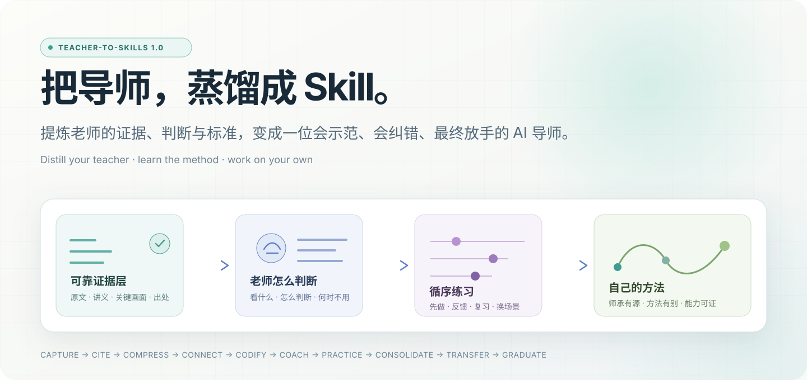
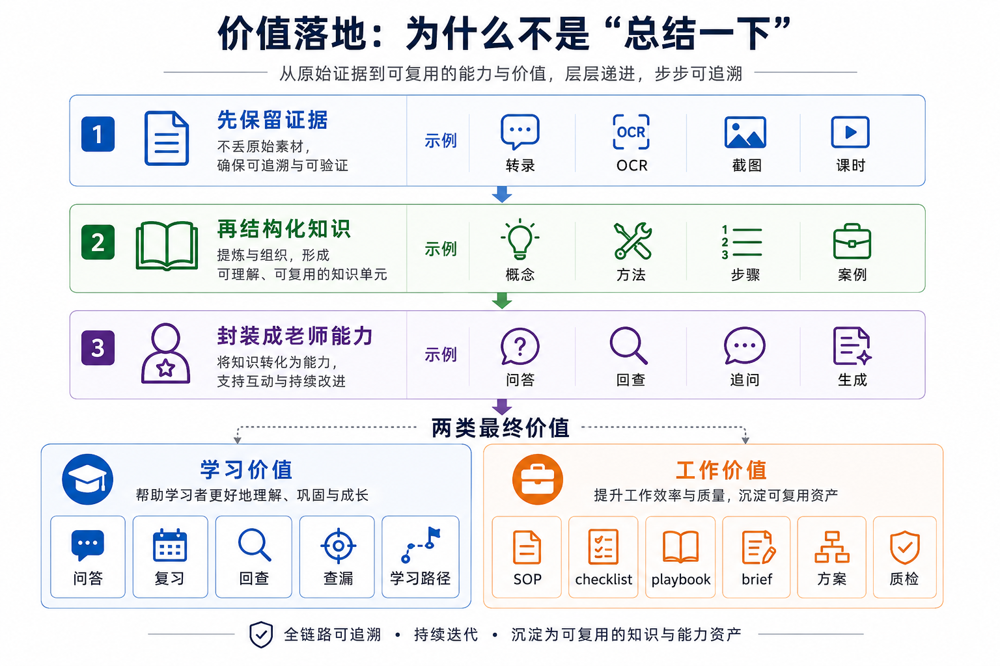
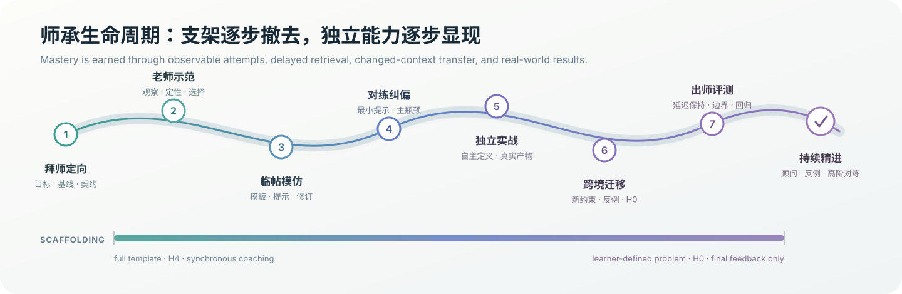
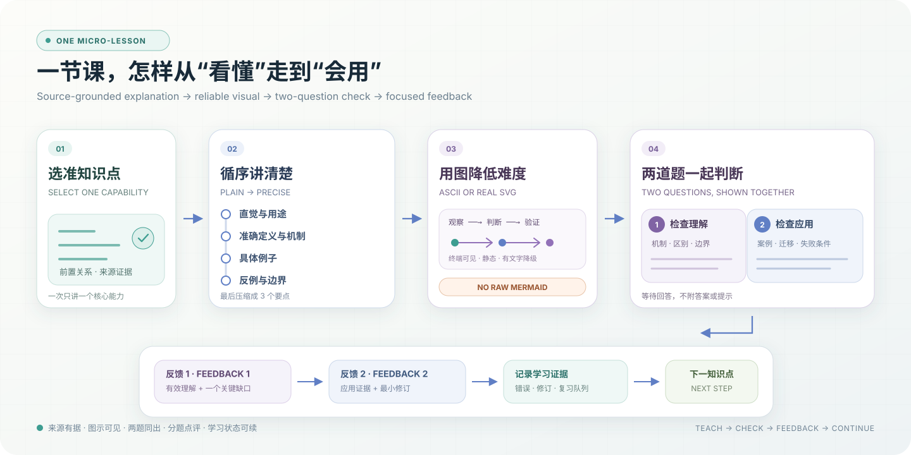
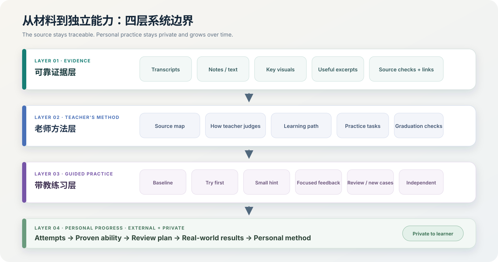

# Teacher-to-Skills

**蒸馏你的老师，变成一个随时能问、会带你练的 Skill**

把老师的课程、书、录音、讲义和批注交给它，它会提炼老师怎么看问题、怎么判断、怎么纠错， 打包成一位有出处的 AI 老师：先示范，再让你动手，按老师的标准给反馈，直到你不再需要它。

[English](./README.en.md) · [安装说明](./docs/install.md) · [更新记录](./CHANGELOG.md)

## 为什么是“蒸馏老师”，而不是“总结课程”

一位好老师最值钱的，往往不是讲义上的结论，而是没写下来的那部分：先看哪里、凭什么下判断、学生最常错在哪、什么情况下这套方法不能用。

普通摘要只留下“老师讲了什么”。Teacher-to-Skills 想留下的是“老师会怎么做”，并且把它变成你自己也能做到的能力。

| | 课程摘要 | 蒸馏出来的老师 Skill |
| --- | --- | --- |
| 留下什么 | 知识点和结论 | 老师的观察点、判断规则、示范和纠错方式 |
| 怎么用 | 你自己去读 | 它出题、你先做，它按老师的标准点评 |
| 可信度 | 难以分辨是原话还是改写 | 重要结论都能回查原文、原话或关键画面 |
| 最终结果 | 读完就结束 | 隔一段时间、换个场景你也能独立做出来 |

## 从老师身上蒸馏出什么

| 蒸馏出的内容 | 具体指什么 |
| --- | --- |
| 出处 | 每条重要结论对应的原文、原话、讲义页或视频画面 |
| 观察点 | 老师面对一个问题时，先看什么、重点盯什么 |
| 判断规则 | 老师凭哪些条件下结论，遇到例外时怎么处理 |
| 示范 | 老师亲自演示的完整做法和其中的关键步骤 |
| 常见错误与纠偏 | 学生通常在哪里出错，老师会怎样指出和纠正 |
| 适用边界 | 这套方法在什么情况下不适用，或需要专业人士介入 |

它**不会**声称复制老师的人格、意识或全部经验。材料里没有的东西，它会标成“证据不足”，不会编造“老师大概会这么说”。

## 蒸馏出来的老师会怎样带你

- **先摸底，再讲课**：了解你的目标、基础和真实应用场景，从你最需要的知识点开始。
- **讲得透**：先建立直觉，再给准确定义、图示、例子、反例和三点小结。图示用各终端都能显示的 ASCII，复杂关系用 SVG。
- **先让你做**：每个知识点讲完一起给出两道题，一道检查理解，一道检查应用，回答后分别点评。
- **按老师的标准纠错**：每轮只抓最关键的一个问题，给刚好够用的提示，并让你自己修订。
- **记得你错过什么**：保存你的尝试、错误和修订，按你的薄弱点安排复习，不重复原题。
- **逐步放手**：随着你进步减少模板和提示，最后用没见过的场景、不给提示地检验你。
- **知道什么时候算出师**：只有隔一段时间还会做、换场景也能用、并且知道方法边界时，才认为你真正学会。

目标不是让你一直依赖这位 AI 老师，而是让你学到老师的方法，最后形成自己的方法。

## 三步上手

你不需要运行脚本，也不需要理解内部文件结构，全程用自然语言和你的 AI 助手说话即可。

### 1. 安装

把[安装说明](./docs/install.md)发给你的 AI 助手（Claude Code、Codex、OpenClaw 等），让它代你安装，装好后按提示重启。

### 2. 交给它老师的材料，开始蒸馏

上传文件或告诉它材料所在的文件夹，然后直接说：

> 请使用 Teacher-to-Skills 蒸馏这位老师的材料，做成一个能带我真正学会的老师 Skill。我的目标是把老师的方法用到真实工作中。重要结论要能回查出处，原始材料和个人学习记录保持私有。请先告诉我识别到了哪些材料、还缺什么；如果没有需要我决定的风险，就继续完成蒸馏、检查并启用新 Skill，最后告诉我怎样开始第一课。

它会盘点材料，完成转录、识别、出处整理、老师方法提炼、练习设计和质量检查。中途中断了也能接着做。

交付时它应该清楚告诉你：

- 老师 Skill 是否已经生成并启用；
- 哪些视频、文档、章节和笔记已经处理；
- 哪些内容证据不足、识别不清或需要你确认；
- 当前能做到完整带教、引导学习，还是只适合查资料；
- 原始材料和个人学习记录保存在哪里，有没有被打包进 Skill。

如果这些没有交代清楚，直接让它补做交付检查。

### 3. 跟着老师学

> 用刚刚生成的老师 Skill 开始带我学习。先问清楚我的目标、基础、每周可投入时间和一个真实应用场景；做一次简短摸底后，从一个知识点开始深入浅出地讲。讲完一起给我两道题，等我回答后分别点评。

之后每次回来，一句话就够：

| 你想做什么 | 可以直接说 |
| --- | --- |
| 继续学习 | “继续上次进度，给我今天最应该做的一项练习。” |
| 问老师会怎么看 | “按老师的方法，这个问题应该先看什么？给出原话出处，这次不用练习。” |
| 提交真实作品 | “这是我按老师方法完成的作品，先按老师的标准评价，再指出最关键的一个问题。” |
| 复习巩固 | “根据我以前的错误安排一次复习，不要重复原题。” |
| 检查迁移 | “换一个我没见过的场景，检查我能不能独立用这个方法。” |
| 解决现实问题 | “先让我说明自己的判断和方案，再用老师的方法帮我纠偏。” |
| 追加新材料 | “这是老师的新课，更新进老师 Skill，保留我原来的学习进度。” |
| 申请出师 | “不要给提示，用新场景检验我是否真的掌握，并说明还缺什么证据。” |

## 能蒸馏哪些材料

| 你手上的材料 | 它会怎么处理 |
| --- | --- |
| 课程视频、讲座录像 | 结合讲解声音、画面、幻灯片、板书和演示进行整理 |
| 录音、播客、访谈 | 转成可检索的文字，并按章节和主题组织 |
| 书籍、PDF、扫描讲义 | 识别正文、结构、表格和重要页面 |
| 文章、笔记、批注、文字稿 | 保留原文位置，提炼方法、案例和练习 |
| 已有的转录或课程整理 | 跳过重复处理，在已有成果上继续 |
| 多位老师的材料 | 分别保留每位老师的观点、适用条件和分歧，不强行拼成一个答案 |

材料不完整也可以开始。它会标出缺失的证据和需要人工确认的地方。材料只够解释概念时，它会如实退回到资料查询或引导学习，不会假装已经具备完整的老师能力。

## 工作原理

| 层次 | 做什么 |
| --- | --- |
| 证据层 | 保存原文、原话、讲义和关键画面，每条结论都能回查 |
| 老师层 | 提炼老师的观察点、判断规则、示范、纠错方式和边界 |
| 练习层 | 按学习顺序设计练习、评分标准、复习和迁移检验 |
| 个人层 | 保存你的尝试和真实结果，经你同意后沉淀成你自己的方法 |

老师的材料和你的学习记录分开保存：老师那部分生成后不再改动，你的进度保存在 Skill 之外的私有目录，重新蒸馏或更新材料都不会丢失学习记录。

## 边界、隐私与版权

- 只蒸馏有出处的方法和判断，不复制老师的人格、意识或全部经验。
- 老师原意、基于材料的整理、AI 的推断和你自己的实践证据会明确区分。
- 原始课程、转录、截图、扫描内容和个人学习记录默认不会打包进生成的 Skill。
- 只有你明确同意后，经过多次实践验证的做法才会被建议为你的个人长期方法。
- 医学、法律、金融、投资等高风险领域仅用于有来源的学习，不能替代专业资质或现实责任。
- 请只蒸馏你有权使用的材料，并遵守课程版权和分发限制。

## 致谢

- [Datawhale](https://github.com/datawhalechina) — AI 教育、开源课程与学习者社区实践。
- [rfeng1016](https://github.com/rfeng1016) — 对渐进知识组织方向的建议。
- [LINUX DO](https://linux.do/) — 中文开发者社区的讨论与反馈。

## License

本项目采用 [Apache License 2.0](./LICENSE)。
